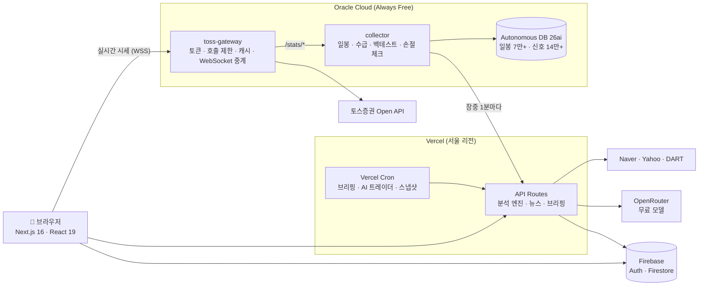

# 📊 주식 AI 분석기

[](https://github.com/jung-ji-su/stock-analyzer/actions/workflows/ci.yml)

한국·미국 주식을 위한 개인 분석 플랫폼. 숫자(예측·확률·목표가)는 **규칙 기반 엔진**이 정하고, LLM은 설명만 씁니다.
엔진 설정은 Oracle DB에 쌓은 3년치 데이터로 **백테스트해서 고른 값**입니다.
같은 DB로 Oracle 26ai의 **AI 벡터 검색**(닮은꼴 차트), `CORR()`(종목 관계 지도), 윈도 함수(고래 추적기) 메뉴도 만들었습니다.

🔗 **Live**: [stock-analyzer-opal-seven.vercel.app](https://stock-analyzer-opal-seven.vercel.app)
📄 **Portfolio**: [jung-ji-su.github.io/stock-analyzer/portfolio.html](https://jung-ji-su.github.io/stock-analyzer/portfolio.html)
👀 **로그인 없이 둘러보기**: 로그인 화면의 「로그인 없이 둘러보기」 → 관계 지도 · 닮은꼴 차트 · AI 성적표 (읽기 전용)

---

## 🏗 아키텍처



| 구성 | 역할 | 왜 이렇게 |
|------|------|-----------|
| **Vercel + Next.js** | 화면 + API 라우트 | 프론트·백엔드를 한 저장소에서, push 하면 배포 |
| **Firebase** | 로그인, 모의투자·예측 기록 | 사용자 데이터는 문서형이 편하고 Auth와 한 번에 |
| **toss-gateway** (VM) | 토스 Open API 프록시 | 토스는 고정 IP 등록 + 클라이언트당 토큰 1개 → 서버리스에서는 불가. 본인 계정만 통과, 조회 전용. 게스트용 공개 통계(Yahoo 일봉·엔진 결과만)는 초당 3건 제한으로 따로 연다 |
| **collector** (VM) | 데이터 수집 + 백테스트 | Vercel 함수는 실행 시간 제한이 있어 3년치 재계산을 못 함. 상시 프로세스가 필요 |
| **Oracle Autonomous DB** | 시계열 + 신호 저장 | 일별 데이터 분석은 SQL 윈도 함수(LEAD, ROW_NUMBER)가 가장 간단. 무료 |
| **OpenRouter** | 분석 설명문 | 무료 모델만 사용, 실패하면 다음 모델 → 그래도 실패하면 엔진이 만든 기본 문장 |

VM 서비스는 저장소 체크아웃에서 바로 실행되고, collector는 앱의 엔진 파일(`lib/analysisEngine.js`)을 그대로 import 합니다 — 백테스트와 실제 화면이 같은 코드입니다. 1분마다 `main`을 따라가고, 바뀐 폴더의 서비스만 재시작합니다.

---

## 🧠 분석 엔진 (`lib/analysisEngine.js`)

LLM에게 "오를까?"를 묻지 않습니다. 엔진이 일봉으로 점수를 계산하고, LLM은 그 결과를 문장으로 풉니다.
LLM이 다른 숫자를 돌려줘도 라우트가 엔진 값으로 덮어씁니다.

| 레이어 | 내용 | 가중치 |
|--------|------|------|
| 기술 | RSI · MACD · 이평 배열 · 볼린저 · 거래량 · 매물대 | 35 |
| 퀀트 | 5일 반전 · 20일 VWAP 괴리 · 1·3개월 모멘텀 · 52주 위치 | 40 |
| 뉴스 | 키워드 감성 (+ 사용자가 돌린 LLM 감성) | 25 |
| 수급 | 외국인·기관 5일 순매수 비중 (토스 데이터) | 참고로만 표시 (검증 결과 개선 없음, 아래 6번) |

스캐너와 AI 트레이더는 같은 엔진 결과로 **매수 점수**(0~100 = 50 + 종합×5 ± 1주 전망 10)를 매깁니다 (`lib/engineScore.js`).

기간별(1일·1주·1달)로 최근 변동성을 써서 **상승 / 횡보 / 하락 확률**을 구하고, 가장 높은 쪽을 예측으로 냅니다.
적중 판정 기준(±1/2/4%)과 확률 계산 기준이 같아서, 화면의 신뢰도가 실제 적중률과 비교 가능합니다.

### 백테스트로 설정 고치기

collector가 시총 상위 100종목의 3년치 일봉으로 **모든 날짜**에 엔진을 돌려 (지표 준비 기간을 빼면 약 2년, 14.5만 건) `engine_signals`에 저장하고,
뷰 `v_signal_eval`이 `LEAD(close, 1/5/20)`로 실제 결과와 맞춰봅니다. 엔진 파일이 바뀌면 전부 다시 계산합니다.

1. **발견** — 예측력은 대부분 "횡보(변동성)" 판단에서 나왔고, 방향 신호는 우연보다 조금 나은 수준. 기존 설정은 신뢰도를 **7~13%p 부풀리고** 있었음
2. **실험** — 확률 파라미터(방향 반영 정도 · 변동성 배수 · 최소 점수) 조합을 기간별로 돌려 적중률·보정 오차·확률 점수를 비교 (`/stats/experiment`)
3. **적용** — 기간별로 가장 나은 조합을 `PROB_PARAMS`에 반영. 방향은 작게(0.1)만 반영하고, 점수가 약하면 횡보
4. **노출** — AI 기록 화면에 쉬운 말 성적표 3문항, 자세한 표는 관리자 › 🧪 검증 탭
5. **매수 기준** — 점수대별 5일 뒤 결과(`/stats/buyscore`)를 보니 예전 기준 75점+는 전체의 16%인데 +2% 상승 확률이 기준선보다 2.5%p만 높고 −2% 하락 확률은 오히려 높았음.
   오를 확률이 확실히 높고 내릴 확률은 높지 않은 첫 구간인 **85점+**(48.5% / 33.8%, 앞·뒤 기간 모두 기준 이상)로 강력매수·AI 트레이더 기준을 올림
6. **수급** — 토스 수급 API의 `until`/`nextUntil` 커서로 3년치를 백필한 뒤, 같은 날짜에 엔진을 수급 없이 / 20% 포함으로 두 번 돌려 비교(`/stats/supply-engine`).
   적중률·Brier·과신이 어느 기간에서도 좋아지지 않았고, 수급을 넣은 85점+는 오히려 나빠짐(+2%↑ 43.3% vs 48.8%) → **점수에서 빼고 참고 신호로만** 표시
7. **시장 분위기** — 시장 지수(상위 100종목 평균)로 날짜마다 국면을 나눠(보통 / 약세 = 20일 평균 아래 / 급락 = 5일 −3%↓) 매수 점수 성적을 비교(`/stats/market`).
   85점+에서 약세 국면만 빼면 +2%↑ 47.9→**50.8%**, −2%↓ 34.6→**32.2%**로 앞·뒤 기간 모두 좋아짐(약세 국면 85점+는 ↑17% ↓57%, 70~84점도 약세에선 ↑33% ↓44%).
   급락 국면은 오히려 반등이 많아서(↑46%) 막지 않음 → **약세 국면엔 AI 트레이더가 새로 사지 않고**, 스캐너에 안내 표시

---

## 🗄 Oracle 26ai로 만든 메뉴

| 메뉴 | 무엇 | Oracle 기능 | 파일 |
|------|------|------|------|
| 🔮 닮은꼴 차트 `/similar` | 지금 20일 차트와 모양이 가장 비슷했던 과거 구간 12개와 그 뒤 흐름 | **AI Vector Search** — 20일 등락 흐름을 정규화한 `VECTOR(20, FLOAT32)` 약 7만 개, `VECTOR_DISTANCE(…, COSINE)` | `collector/src/similar.js` |
| 🕸️ 관계 지도 `/network` | 같이 움직이는 종목 그룹, 그룹별 수익률·결속력, 종목별 같이/따로 움직이는 종목 | `CORR()` 로 100종목 모든 쌍(4,950쌍) 상관을 쿼리 한 번에 → 평균 연결 군집 | `collector/src/network.js` |
| 🐋 고래 추적기 `/whales` | 외국인·기관이 1·3·6개월 동안 무엇을 얼마어치 샀나, 조용히 모으는 종목 | 순매수 수량 × 종가 합산, `SUM() OVER (ORDER BY …)` 누적, `KEEP (DENSE_RANK FIRST/LAST)` 기간 수익률 | `collector/src/whales.js` |
| 🏦 수급·신고가 `/scanner` | 외국인·기관 연속 순매수, 52주 신고가 근처 | `ROW_NUMBER()` 로 연속 일수 끊기는 지점 찾기 | `collector/src/screens.js` |

---

## 🗺 메뉴

| 경로 | 화면 | 설명 |
|------|------|------|
| `/` | 홈 | 검색 · 차트(매물대·이평·볼린저·VWAP) · AI 분석 · 모의 주문 · 실시간 시세 |
| `/deep-analysis` | 딥분석 | 15개 이상 지표 + 수급 + 뉴스 리포트 |
| `/scanner` | 스캐너 | 지표 스캔 + **수급·신고가** (외국인·기관 연속 순매수, 52주 신고가 근처 — Oracle SQL) |
| `/briefing` | 시황 브리핑 | 장 전·장중·장 마감 구분 브리핑, 토스 실시간 순위 |
| `/calendar` | 캘린더 | 휴장일 · FOMC/금통위/CPI · 옵션 만기 + 관심·보유 종목 실적/배당 |
| `/market-map` | 시장 지도 | 시가총액 트리맵 |
| `/financial` | 재무분석 | DART 재무제표 + AI 해석 |
| `/wiki` | 백과사전 | 테마·섹터별 종목 |
| `/invest` | 모의투자 | 포트폴리오 · 거래 내역 (국내·미국, 원화 환산) |
| `/history` | AI 기록 | 예측 이력 · 적중률 · 보정 · **엔진 성적표**(1주 적중률·확률 정직도·강력매수 성과). 게스트는 성적표만 |
| `/ranking` | 랭킹 | 예측 정확도 순위 |
| `/ai-trader` | AI 트레이더 | 매수 점수 85+ 자동 매수 (백테스트로 정한 기준), 시장 약세 국면엔 쉼, ATR 손절(−2ATR)·익절(+3ATR) |
| `/similar` | 닮은꼴 차트 | 최근 20일과 닮은 과거 구간 겹쳐 보기 (Oracle 벡터 검색). 게스트는 예시 종목 |
| `/network` | 관계 지도 | 같이 움직이는 종목 그룹 · 상관 히트맵 (Oracle `CORR`). 게스트 가능 |
| `/whales` | 고래 추적기 | 외국인·기관 순매수 금액 순위 · 누적 흐름 (토스 수급 데이터라 로그인 필요) |
| `/admin` | 관리자 | 🩺 운영(게이트웨이·수집기·크론 상태, AI 호출 통계, 데이터 정리) · 🧪 검증(백테스트 상세 표) · 👥 사용자 |

---

## 📁 저장소 구조

```
stock-analyzer/          Next.js 앱 (Vercel)
  app/                   화면 + api/ 라우트
  components/            화면 조각 (home/, stock/, ui.js …)
  lib/                   공통 모듈
    analysisEngine.js    점수·확률 엔진 (순수 함수, collector도 import)
    indicators.js        SMA/EMA/RSI/MACD/볼린저/ATR/OBV
    openrouter.js        모든 LLM 호출 (무료 모델 재시도·대체)
    evalUtils.js         적중 판정 · 정확도 · 보정
    engineScore.js       매수 점수 · 등급 (스캐너·AI 트레이더 공통)
    marketRegime.js      오늘 시장 국면 (약세면 AI 트레이더 쉼)
    firebase.js / db.js  Auth / Firestore 분리 (DB 안 쓰는 화면은 Firestore를 안 받음)
  test/                  엔진·매수 점수·평가 단위 테스트 (node --test)
toss-gateway/            토스 API 프록시 (VM, Node 22)
collector/               수집기 + 백테스트 + Oracle 통계 API (VM, Node 22, oracledb)
  src/stats.js           백테스트 · 매수 점수 · 수급 검증
  src/supplyEngine.js    수급 포함 엔진 비교
  src/similar.js         닮은꼴 차트 (벡터 검색)
  src/network.js         관계 지도 (CORR + 군집)
  src/whales.js          고래 추적기
  src/market.js          시장 분위기 검증 · 오늘 국면
portfolio.html           포트폴리오 문서 (GitHub Pages)
```

---

## 🚀 로컬 실행

```bash
cd stock-analyzer
npm install
npm run dev      # http://localhost:3000
npm run lint
npm test         # 엔진·매수 점수·평가 단위 테스트
```

```bash
cd collector && npm test       # SQL·통계 단위 테스트
cd toss-gateway && npm test    # 모의 토스 서버로 테스트
```

CI(GitHub Actions)는 push마다 앱 린트·테스트, 수집기·게이트웨이 테스트를 돌립니다.

### 환경변수 (`stock-analyzer/.env.local`)

```env
OPENROUTER_API_KEY=
NAVER_CLIENT_ID=
NAVER_CLIENT_SECRET=
DART_API_KEY=
KRX_API_KEY=
NEXT_PUBLIC_FIREBASE_API_KEY=
NEXT_PUBLIC_FIREBASE_AUTH_DOMAIN=
NEXT_PUBLIC_FIREBASE_PROJECT_ID=
NEXT_PUBLIC_FIREBASE_STORAGE_BUCKET=
NEXT_PUBLIC_FIREBASE_MESSAGING_SENDER_ID=
NEXT_PUBLIC_FIREBASE_APP_ID=
FIREBASE_SERVICE_ACCOUNT_KEY=
NEXT_PUBLIC_TOSS_GATEWAY_URL=
NEXT_PUBLIC_BASE_URL=
CRON_SECRET=
```

VM 쪽 비밀값은 `/etc/toss-gateway.env`, `/etc/stock-collector.env`에만 있습니다 (예시: 각 폴더의 `deploy/`).

---

## ⏱ 정기 작업

| 어디서 | 언제 (KST) | 무엇 |
|--------|-----------|------|
| Vercel Cron | 평일 08:00 | 시황 브리핑 생성 |
| Vercel Cron | 평일 17:30 · 23:00 | AI 트레이더 매수 · 점검 |
| Vercel Cron | 평일 00:00 | 일일 스냅샷 |
| collector | 거래일 16:30 이후 1회 | 일봉 · 수급 수집 → 엔진 신호 계산 → 닮은꼴 차트 벡터 재생성 |
| collector | 장중 1분마다 | AI 트레이더 손절·익절 체크 |
| VM 타이머 | 1분마다 | `main` 따라가기 + 바뀐 서비스 재시작 |
